# 🏦 YONO SBI Mobile Banking App — UI/UX Redesign Case Study

[](https://www.behance.net/gallery/240926235/YONO-SBI-App-Redesign-UXUI-Case-Study)
[](https://figma.com)
[](https://creativecommons.org/licenses/by-nc/4.0/)
[](https://www.behance.net/anushkounain)

> **Live Case Study:** Explore the original, interactive design case study on [Behance](https://www.behance.net/gallery/240926235/YONO-SBI-App-Redesign-UXUI-Case-Study).

---

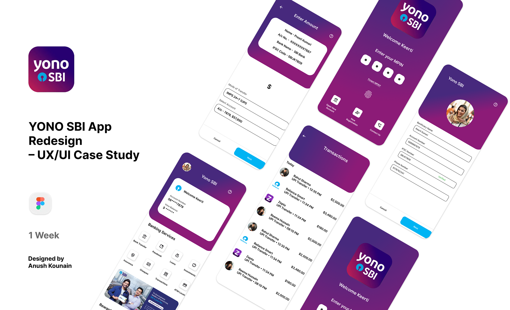

---

## 📌 Table of Contents
1. [Project Overview](#-project-overview)
2. [Why This Project?](#-why-this-project)
3. [Problem Statement](#-problem-statement)
4. [Existing Experience & Key UX Issues](#-existing-experience--key-ux-issues)
5. [Design Goals](#-design-goals)
6. [Design Process](#-design-process)
7. [User Research & Personas](#-user-research--personas)
8. [Information Architecture](#-information-architecture)
9. [User Flows](#-user-flows)
10. [Visual Style Guide](#-visual-style-guide)
11. [Wireframes (Low-Fidelity)](#-wireframes-low-fidelity)
12. [High-Fidelity UI Screens](#-high-fidelity-ui-screens)
13. [Key Design Decisions](#-key-design-decisions)
14. [Learnings & Takeaways](#-learnings--takeaways)
15. [Tools & Technologies](#-tools--technologies)
16. [Author & Credits](#-author--credits)
17. [Disclaimer](#-disclaimer)

---

## 📖 Project Overview

**YONO SBI** (*You Only Need One*) is a digital banking application by the **State Bank of India (SBI)** that enables millions of users across India to carry out daily banking activities—such as checking account balances, transferring funds, paying utility bills, and managing financial services.

As an active user of the application, I observed usability and UI challenges that make frequent, essential banking tasks feel confusing and time-consuming. This project is a comprehensive concept redesign focused on:
- Improving usability and ergonomics.
- Streamlining navigation hierarchies.
- Creating a modern, clear, and reassuring banking experience.

---

## 🎯 Why This Project?

Banking applications are mission-critical digital products used daily by individuals across diverse age groups, technical fluencies, and backgrounds. Enhancing visual clarity and operational simplicity directly impacts user confidence when handling financial transactions. 

I undertook this project to:
- Deepen and practice core UI/UX fundamentals.
- Understand how product design solves friction points in high-volume, real-world utility apps.
- Explore accessible interface solutions for varied digital banking demographics.

---

## ❗ Problem Statement

While using the YONO SBI application, key banking features can be difficult to locate due to interface clutter. New and non-technical users often face confusion completing basic tasks such as:
* Initiating fund transfers.
* Completing recurring bill payments.
* Reviewing and filtering transaction history.

The lack of distinct navigation paths and clear visual hierarchy introduces friction and cognitive fatigue, detracting from the overall banking experience.

---

## 🔍 Existing Experience & Key UX Issues

An audit of the existing mobile banking flow highlighted three primary usability bottlenecks:

| Screen / Area | Identified Usability Bottleneck |
| :--- | :--- |
| **Login Screen** | Multiple fragmented authentication paths causing initial decision paralysis and confusion. |
| **Home Screen** | Feature overload on the dashboard, diminishing the discoverability of frequent daily banking actions. |
| **Transaction History** | Poor readability, weak scannability, and limited visual hierarchy for tracking incoming/outgoing amounts. |

### Visual Breakdown of Existing Issues

#### 1. Login Screen Usability Issues
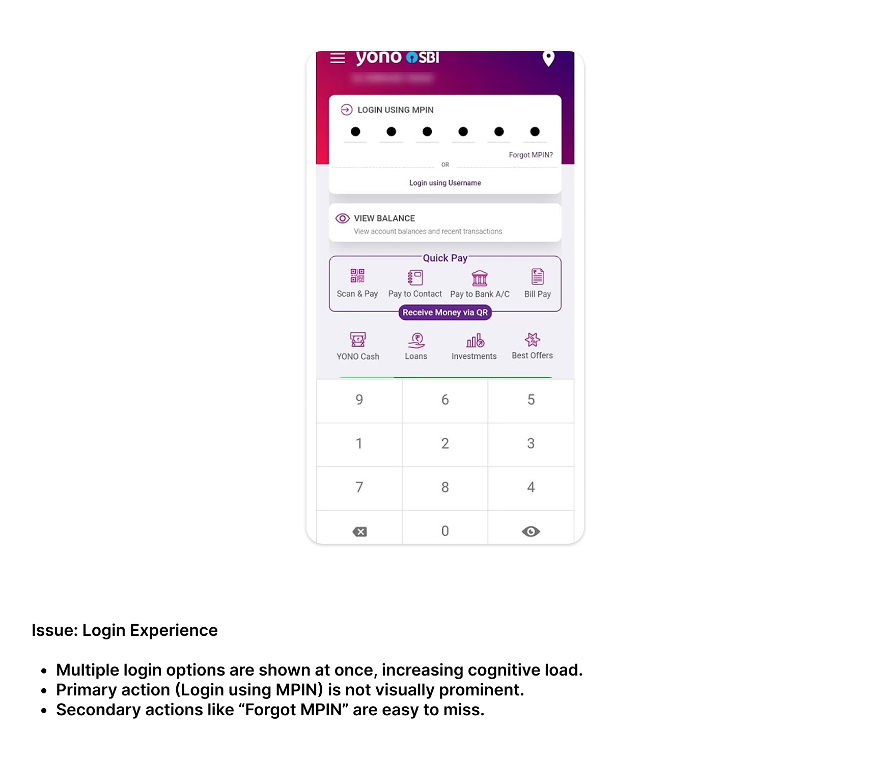

#### 2. Home Screen Usability Issues
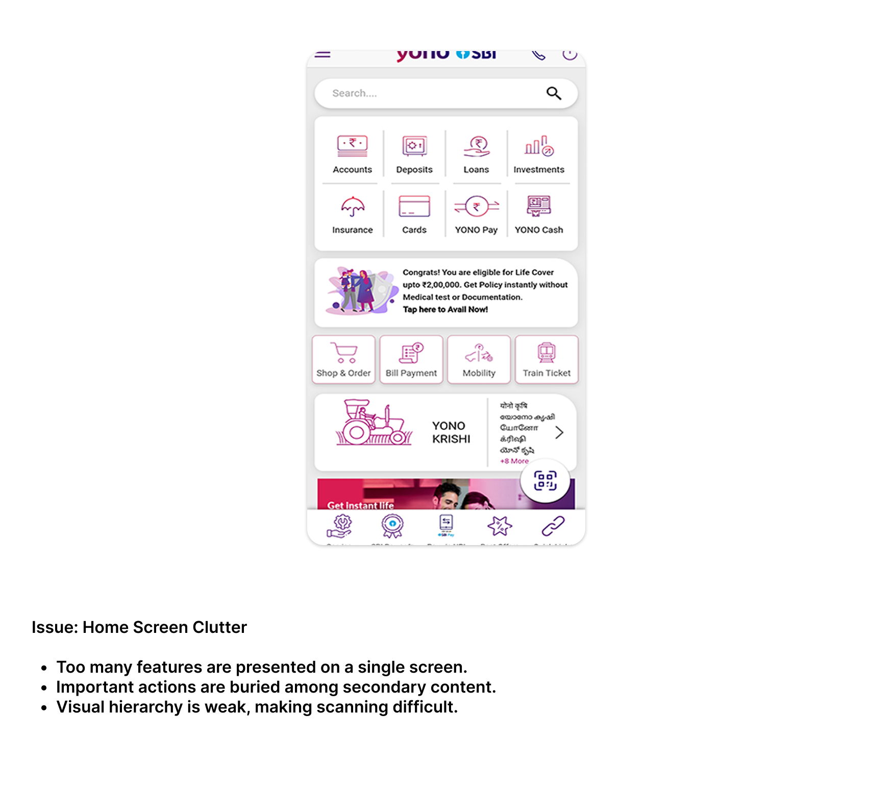

#### 3. Transaction History Usability Issues
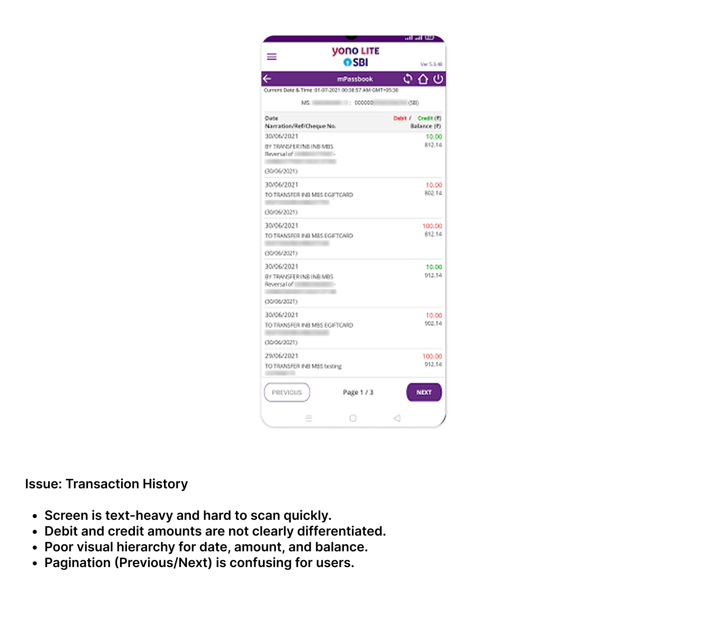

> **Note:** Due to copyright and privacy considerations, direct screenshots from the live YONO SBI app are limited. Visuals presented here serve as analytical references to highlight usability issues identified during real usage.

---

## 🎯 Design Goals

To address the observed friction points, the redesign focuses on four core objectives:

```
┌─────────────────────────────────┐      ┌─────────────────────────────────┐
│     Simplify Authentication     │      │      Declutter Home Screen      │
│  Streamlined PIN and biometric  │ ───► │ Highlight primary actions while │
│    login without confusion.     │      │   reducing visual overload.     │
└─────────────────────────────────┘      └─────────────────────────────────┘
                 │                                        │
                 ▼                                        ▼
┌─────────────────────────────────┐      ┌─────────────────────────────────┐
│    Readable Transaction Data    │      │    Prioritized Core Actions     │
│  Easier scanning of debits,     │ ───► │ Effortless access to balance    │
│  credits, dates, and details.   │      │ checks, transfers, and bills.   │
└─────────────────────────────────┘      └─────────────────────────────────┘
```

* **Simplify the login and authentication flow** to get users safely into their accounts with minimal taps.
* **Improve home screen clarity** by decluttering visual noise and surfacing primary daily actions.
* **Make transaction history easier to scan and understand** through structured typographic scales and clear financial indicators.
* **Highlight primary actions** such as quick payments, fund transfers, and balance inquiries.

---

## 🔄 Design Process

A structured, user-centered design approach guided every stage from discovery to final high-fidelity screens:

```
Research  ────►  Define  ────►  Ideate  ────►  Design
```

1. **Research:** Audited personal usage, analyzed existing app journeys, and gathered informal feedback from active mobile banking users.
2. **Define:** Synthesized pain points, established user personas, and set measurable design objectives.
3. **Ideate:** Structured information architecture and mapped intuitive user flows for primary tasks.
4. **Design:** Built low-fidelity structural wireframes, developed the visual style guide, and designed polished high-fidelity UI screens.

---

## 👥 User Research & Personas

Informal user research and real-world observations revealed diverse user behaviors and pain points. To ground design decisions, three user personas were developed representing different user demographics:

### Persona 1
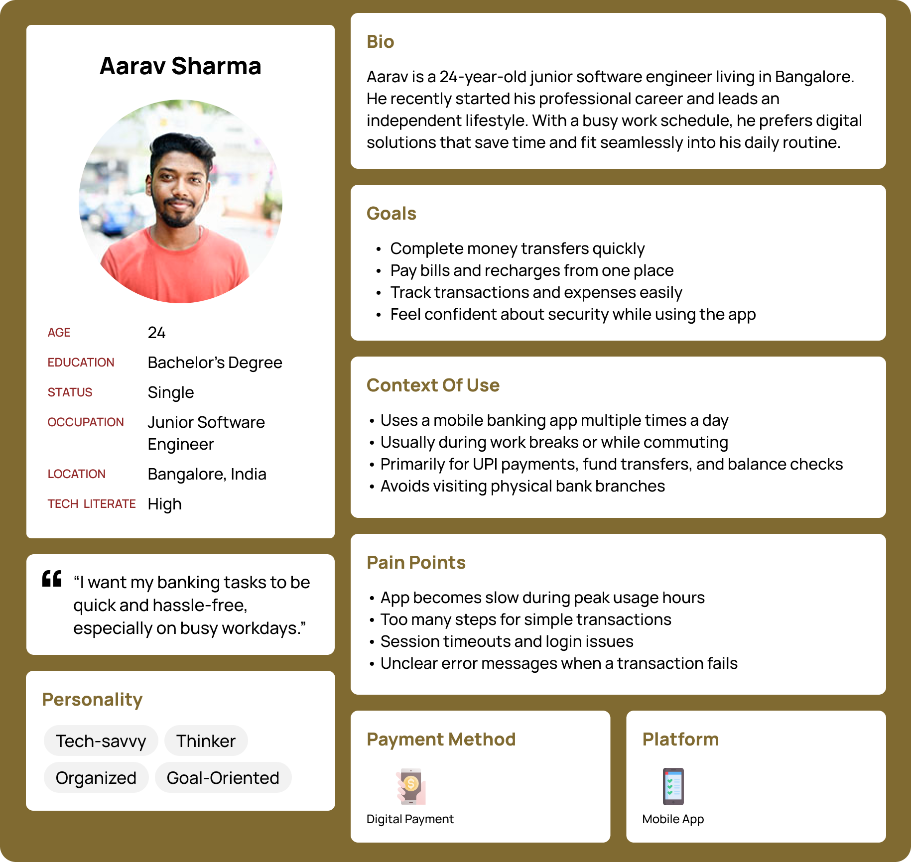

### Persona 2


### Persona 3
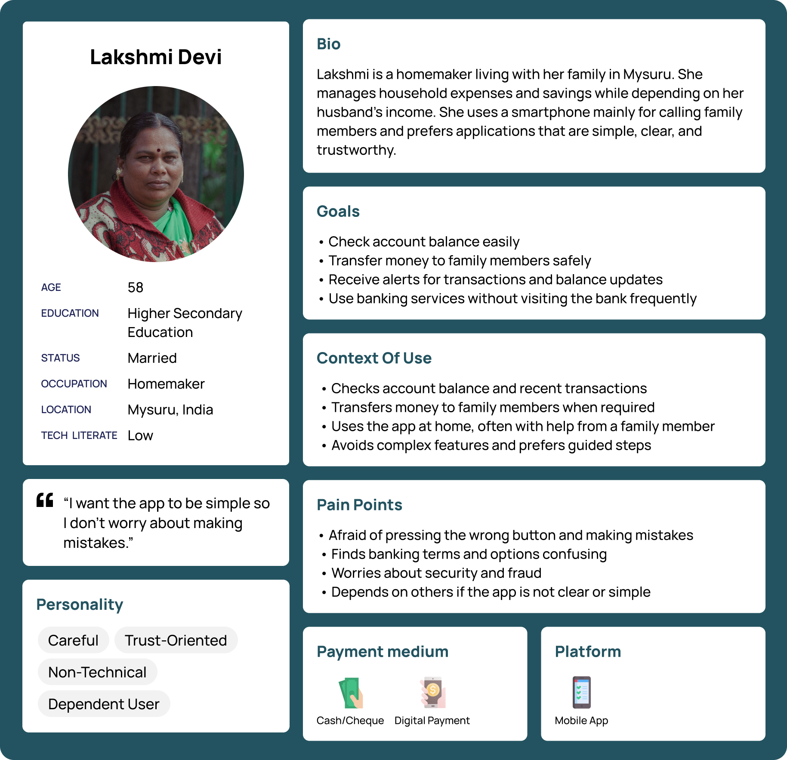

---

## 🏗️ Information Architecture

The redesigned information architecture categorizes core banking capabilities into structured, logical clusters. By minimizing menu nesting and grouping related features together, users can locate essential services without navigational friction.

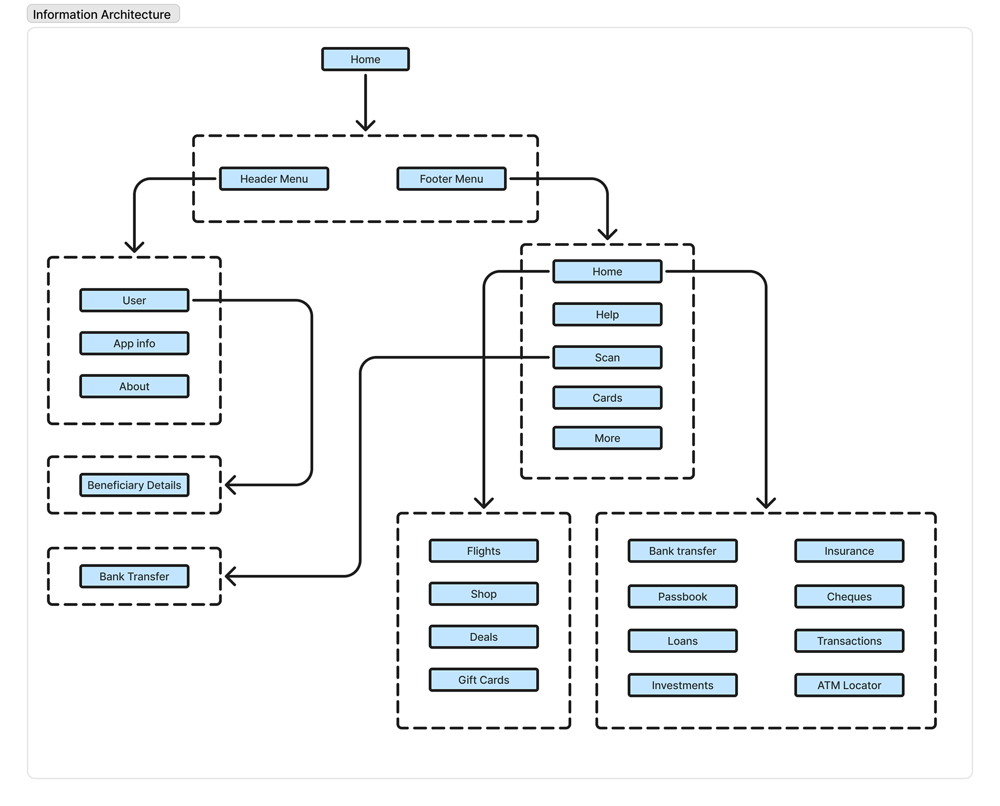

---

## 🗺️ User Flows

Task flows were mapped out to ensure clear, seamless paths for high-frequency actions:

### 1. Login User Flow
Outlines the authentication process, integrating secure PIN and biometric options for fast, frictionless account entry.

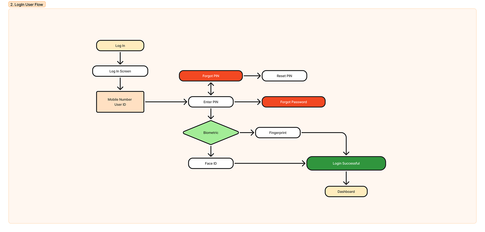

### 2. Money Transfer User Flow
Maps the end-to-end journey from beneficiary selection to transaction confirmation, amount entry, and receipt delivery.

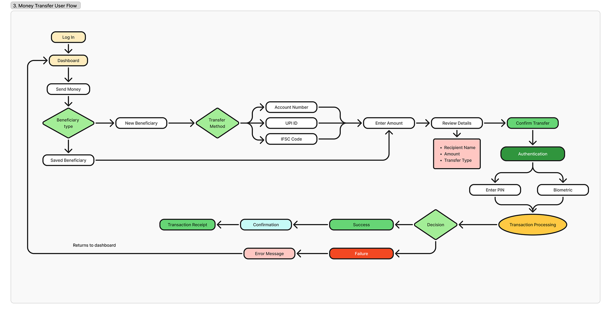

### 3. Bill Payment User Flow
Illustrates the payment sequence from category selection and biller lookup to reviewing charges and completing payments securely.

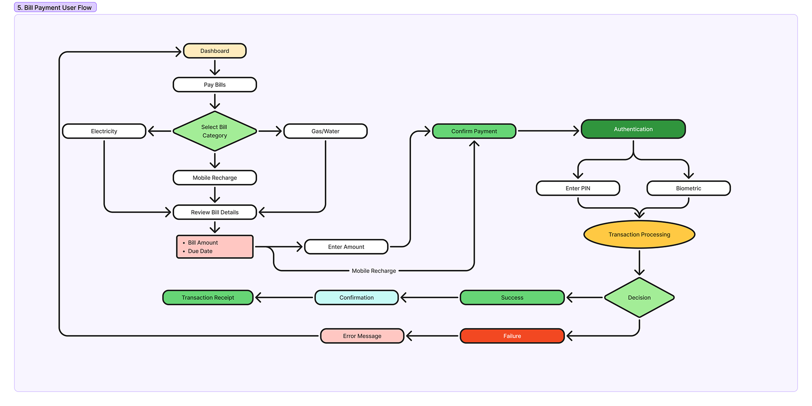

---

## 🎨 Visual Style Guide

A dedicated visual style guide ensures consistency, accessibility, and visual harmony across all screens. The design system features:
* **Typography:** Clean, legible sans-serif type hierarchy tuned for rapid scannability on mobile screens.
* **Color Palette:** Professional banking tones leveraging trusted blues, vibrant purples, and high-contrast semantic accents for financial status indicators.

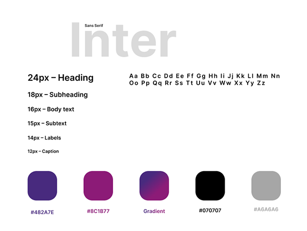

---

## 📐 Wireframes (Low-Fidelity)

Before finalizing visual elements, low-fidelity wireframes were developed to iterate on layout structures, component placement, and screen hierarchies without the distraction of colors and styling.

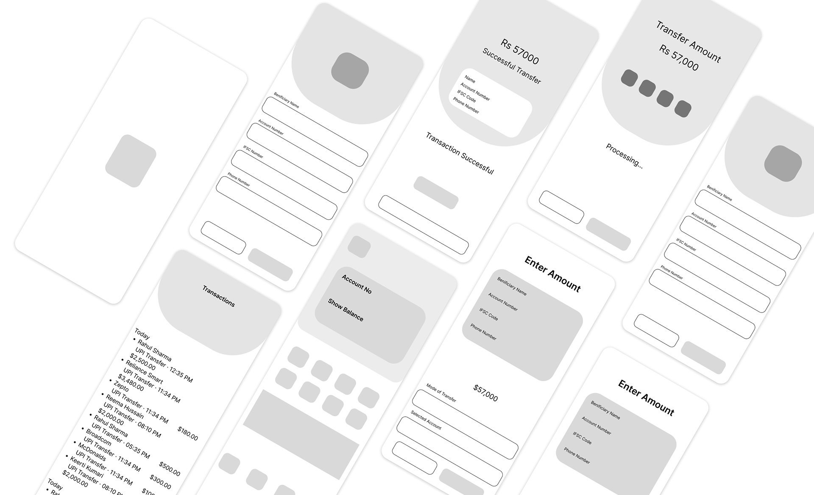

---

## ✨ High-Fidelity UI Screens

Approved wireframes were refined into polished, production-ready high-fidelity screens incorporating the style guide, consistent micro-components, deliberate spacing, and intuitive visual affordances.

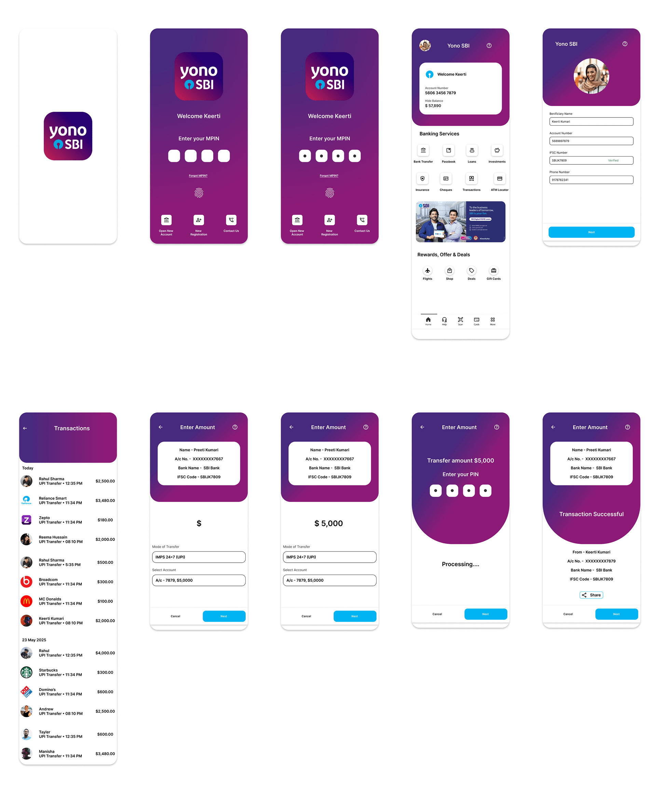

---

## 💡 Key Design Decisions

* **Simplified Dashboard:** Structured the primary home dashboard to place top everyday banking tasks (balance inquiry, quick transfer, bill payment) immediately within thumb reach.
* **Scannable Transaction History:** Enhanced readability with distinct visual hierarchy, clean card separation, and clear visual cues for credits and debits.
* **Reduced Cognitive Load:** Grouped related inputs and secondary options into contextual sheets and clear steps, eliminating feature overload.

---

## 📚 Learnings & Takeaways

* **End-to-End UX Lifecycle:** Gained hands-on experience structuring a comprehensive case study from initial discovery and user personas through to wireframing and final visual execution.
* **Validation through Wireframing:** Understood the critical importance of validating layout hierarchy in low-fidelity before committing to high-fidelity design systems.
* **Designing for High-Trust Domains:** Learned to balance safety, clarity, and speed when crafting user experiences for complex financial workflows.

---

## 🛠️ Tools & Technologies

| Tool | Purpose |
| :--- | :--- |
| **Figma** | Interface Design, High-Fidelity Prototyping, Component Systems |
| **FigJam** | Information Architecture, User Flows, Persona Mapping |
| **Git & GitHub** | Version Control and Project Documentation Showcase |

---

## 👨‍💻 Author & Credits

* **Case Study & UI/UX Design:** **Anush Kounain**
* **Behance Portfolio:** [@anushkounain](https://www.behance.net/anushkounain)
* **Full Case Study:** [YONO SBI App Redesign on Behance](https://www.behance.net/gallery/240926235/YONO-SBI-App-Redesign-UXUI-Case-Study)

---

## ⚖️ Disclaimer

*This project is an academic concept redesign created for educational, portfolio, and UX practice purposes. It is not affiliated with, endorsed by, or connected to the State Bank of India (SBI) or YONO SBI.*
